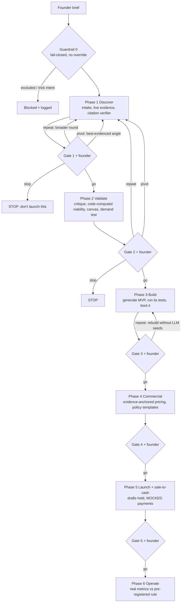

# Architecture: HatchAI, an evidence-gated open-source venture builder

## Overview

HatchAI takes a founder's brief through six phases toward a validated, sellable **digital** product. It has two layers:

* **Control plane (deterministic Python).** `orchestrator.py` is a persisted state machine. `gates.py` computes every gate outcome (GO / REPEAT / PIVOT / STOP) from structured data. `approval.py` enforces founder decisions with a per-run token, and `callbacks.py`/`db.py` append every agent action to the decision log. **No LLM can score, approve, publish or advance a run.**
* **Agent plane (`agents/`).** Agents do the language work: intake, research synthesis, red-team critique, product naming and seed content. They use an **open-weight model only**: Ollama locally (default `qwen3:8b`) or Llama 3.3 70B on Groq's free tier. A closed-weight model name is refused in code (`llm_gateway.is_open_weight`). With no model reachable, every agent has a labelled deterministic path, so the full pipeline still runs at USD 0.

The key design choice is that **LLMs propose and code decides**. Evidence is collected by code, quotes are re-verified by code, and scores are computed by code. The MVP is assembled from tested templates and then proven by actually running its tests.



## Phases

### Phase 1: Discover

* **Agents:** `agents/intake.py` and `agents/researcher.py`. **Tools:** `evidence.py` (collectors, ledger, verifier).
* **Method:**
  1. **Intake.** A deterministic parser extracts the target user, geography, skills, budget, hours, values and language. Any field the founder did not state is written as `UNKNOWN` and listed in `unknown_fields`. An optional LLM can rephrase stated fields, but cannot turn a guess into a fact: unstated fields keep an `ASSUMPTION` prefix.
  2. **Guardrail 0** runs on the brief, and again on any pivot idea.
  3. **Evidence collection (no LLM, keyless, free).** Category queries are sent to web search via `ddgs` (several backends tried in turn), Hacker News (Algolia API), Wikipedia (MediaWiki API) and the World Bank Indicators API (internet use and GDP per capita for the detected country). Pages are fetched and the best sentences are kept. Lines that look like prompt injection are dropped and ad-redirect URLs are filtered. Each source enters a **ledger** with key `S1..Sn`, URL, title, domain, fetch time, SHA-256 of the text, collector and category.
  4. **Synthesis.** With an LLM, the model sees only `[S#] passage` lines and writes claims with a source key and a verbatim quote. Without an LLM, *extractive mode* turns the most relevant passages into claims verbatim. A passage qualifies only if it matches both idea terms and the category's vocabulary and is not navigation text.
  5. **Citation verifier.** Unknown keys are dropped. Each quote must occur in a passage of a cited source (normalised substring or ≥ 0.9 fuzzy window). Claims that fail become `ASSUMPTION (citation not verified)`. Categories with no verified claim get an explicit `ASSUMPTION` placeholder.
* **Output:** `phase1_step1_intake.md`, `phase1_step2_research-findings.md` (claims with links, evidence-score breakdown, ledger) and `phase1_step3_sources.json`.

### Phase 2: Validate

* **Agent:** `agents/validator.py`.
* **Method:** Each evidence gap becomes a kill assumption with a falsifiable kill criterion, and willingness to pay is always treated as untested. **Viability (1–5) is computed in code** (`gates.compute_viability`): base 1, verified demand +1, verified competitors / pricing / local constraints +0.5 each, build skills +0.5, ≥ 5 h/week +0.25, all risks testable +0.25, demand test passed +0.5 (always 0 before launch, so pre-launch V ≤ 4.5). An LLM critique, if available, is appended as text and may add risks, but it cannot change the score. The Lean Canvas links each block to the source keys of verified claims, or labels it `ASSUMPTION`. The demand test is **pre-registered** (GO ≥ 10 % sign-up from ≥ 300 visitors, STOP < 3 %, 14 days, cost ≤ 10 % of budget) with `status: NOT_RUN`.
* **Output:** `phase2_step1_critique.md`, `phase2_step2_lean-canvas.md`, `phase2_step3_demand-test-plan.md`.

### Phase 3: Build

* **Agent:** `agents/builder.py`. **Templates:** `mvp_templates/` (stdlib-only Python).
* **Method:**
  1. **Template choice with a compatibility threshold.** Keywords score the idea against each template (strong keyword = 2, weak = 1, each counted once). A template is chosen only if it scores ≥ 2 and beats the runner-up by ≥ 1 (`config/gates.yaml`). Otherwise there is **no default**: no code is generated, `phase3_step1_mvp-spec.md` becomes an `UNSUPPORTED — spec only (STUBBED)` document explaining why, and Gate 3 recommends STOP. Ideas that fit two templates equally are treated as ambiguous and also rejected. Each archetype has real domain logic and unit tests: `spaced_repetition` (SM-2 scheduling, due queue, stats), `booking` (capacity, duplicate and clash checks, cancellation), `habit_tracker` (idempotent check-ins, streaks, weekly targets), `directory` (ranked search, filters, rate-limited inquiries), `course` (ordered lessons, minute-weighted progress, certificates).
  2. **AppSpec**: product name, fields, a feature list where each feature is traced to the canvas problem, a key metric or the riskiest assumption, and sample seed content derived from the brief (for example, bilingual Arabic/English STEM cards for an Arabic STEM brief). An LLM may write the name, tagline and seeds, **never code**, and every seed must pass the archetype's `validate()`.
  3. **Render** to `generated_mvps/<run>/`: SQLite store, JSON API, web UI (with an RTL toggle when Arabic is requested), page-visit counting and a consented waitlist that are the demand-test instrument (REAL vs TEST traffic labelled), a free-tier item limit, and an **idea-specific `tests/test_spec.py`** with one test per feature.
  4. **Verify for real**: `python -m unittest discover` runs in a subprocess (about 20 tests: domain, HTTP integration, spec). Then `server.py` is booted on a free port and `/health` and `/api/items` are checked.
* **Output:** `phase3_step1_mvp-spec.md`, `phase3_step2_mvp-source.md` (idea-specific source shown in full), `phase3_step3_mvp-test-report.txt` (raw test output).

### Phase 4: Commercial setup

* **Agent:** `agents/commercial.py`.
* **Method:** Monthly prices (`$x/month`) are extracted from fetched passages, and each one keeps its source URL. Anchor = median. Entry price = 50 % of the anchor (`ASSUMPTION`), capped at 1 % of monthly GDP per capita when the World Bank row was fetched. The core stays free, and paid tiers add capacity only. Terms, privacy and refund templates are labelled *MOCKED, not legal advice*.
* **Output:** `phase4_step1_pricing.md`, `phase4_step2_policies.md`.

### Phase 5: Sell, deliver, get paid

* **Method:** The launch copy is drafted in the founder's voice, with no testimonials, counts, countdowns or promises, and stays `PENDING_FOUNDER_APPROVAL`. Nothing is ever posted. The sale-to-cash path runs as a **MOCKED** local simulation priced at the Phase 4 Plus tier (see Sale to cash).
* **Output:** `phase5_step1_launch-drafts.md`, `payment_test_log.md`.

### Phase 6: Operate and learn

* **Agent:** `agents/operate.py`.
* **Method:** Reads stored counts only, using the generated MVP's own `Store.metrics()` on its `app.db`: page visits, unique visitors (random `hatchai_vid` cookie) and consented waitlist sign-ups, plus test-mode orders and refunds. Thresholds (minimum unique visitors, GO and STOP sign-up rates) come from the `DemandTest` stored in Phase 2. `decide()` (INSUFFICIENT_DATA / PERSEVERE / PIVOT / STOP) is applied to **real traffic only**.
* **TEST traffic:** `demand_test_traffic.py` starts an MVP and sends visits and sign-ups that carry `X-HatchAI-Traffic: TEST`, `test-` visitor ids and `@example.com` addresses; the MVP stores them as TEST events. Phase 6 shows them in a separate "pipeline check, NOT demand" section and never uses them in the decision. `python orchestrator.py measure <run>` re-runs Phase 6 on a completed run. The committed demo sends 300 TEST visitors and 20 TEST sign-ups: real counts stay 0, so the decision is `INSUFFICIENT_DATA`. A table labelled `SYNTHETIC` still shows how the rule decides on hypothetical inputs.
* **Output:** `phase6_step1_operate-memo.md`.

## Gates

All thresholds live in `config/gates.yaml`. Each gate writes `phaseN_gate_decision.md` with its checks and the gate history of the run, then **waits for a founder decision** (`approval.py`):

| Gate outcome | Founder may choose |
|---|---|
| GO | approve, stop |
| REPEAT | repeat, stop, override (written reason) |
| PIVOT | pivot, stop, override (written reason) |
| STOP | stop, override (written reason) |

Guardrail 0 blocks create no gate record, so they cannot be overridden.

**Evidence score E (0–100), verified claims only:** category coverage 40, verified ratio 25, cited-domain diversity 20, source-type triangulation (web / HN / Wikipedia / World Bank) 15.

* **Gate 1:** **STOP** if the brief names neither a target user nor a geography, or if E < 25 after the retry budget. **GO** if E ≥ 55, demand is verified and ≥ 3 cited domains. **REPEAT** (broader, rephrased queries; the ledger is merged) while `round < 2`. **PIVOT** to the first opportunity angle once retries are exhausted and E ≥ 25 (max 1 pivot). Otherwise STOP.
* **Gate 2:** **STOP** if E < 35 or V < 2. **GO** if E ≥ 55, V ≥ 3 and every high-risk assumption has a kill criterion. **PIVOT** when evidence is good but V < 3. **REPEAT** (another research round) while budget remains. Otherwise STOP.
* **Gate 3:** **STOP** at once if no tested template fits the idea; a rebuild cannot change that. The founder may stop, or override with a written reason to continue planning without an MVP. Otherwise GO only if files were generated, ≥ 6 generated tests ran with 0 failures and 0 errors, every feature is traced, the server smoke test passes and no forbidden phrase appears. A failure means **REPEAT** (rebuild without LLM seed content); a second failure means **STOP**.
* **Gate 4:** pricing tiers with a free core tier, terms, privacy, refund, the "not legal advice" label, and no income promises (output scanner).
* **Gate 5:** idempotency, revocation and reconciliation all PASS, launch drafts are held for approval, and they contain no forbidden phrases.

**When the system recommends STOP on weak evidence:** the committed demo's weak brief ("generic study notes", no user, no country, no budget) is stopped at Gate 1 before any spending. The tests (`tests/test_pipeline.py`) also run REPEAT → GO and REPEAT → PIVOT → REPEAT → STOP end to end.

## Sale to cash

**Status: MOCKED.** There are no processor SDKs and no keys, and no money is held or moved. Code: `payments.py`, `delivery.py`, `refunds.py`, `reconcile.py`.

```mermaid
sequenceDiagram
    participant Buyer as Test buyer
    participant Pay as payments.py
    participant Del as delivery.py
    participant Ref as refunds.py
    participant Rec as reconcile.py
    Buyer->>Pay: checkout.completed {order_id, idempotency_key} + HMAC
    Pay->>Pay: verify HMAC; event_id = idempotency_key (PRIMARY KEY)
    Pay->>Del: issue_entitlement(order) (idempotent per order)
    Buyer->>Pay: same event replayed
    Pay-->>Buyer: duplicate_replay, original token, no second delivery
    Buyer->>Ref: refund (simulated; real refunds are issued by the founder)
    Ref->>Del: entitlement REVOKED, token invalid
    Rec->>Rec: orders x events x settlement lines (gross, fee, refund, payout)
```

1. **Payment triggers delivery:** a verified `checkout.completed` event marks the order PAID and issues one access token.
2. **Refund revokes access:** `check_entitlement` returns `token revoked` afterwards.
3. **Idempotency:** the event id is the idempotency key. A replay returns the original receipt and token, and a forged signature is rejected.
4. **Reconciliation:** every PAID or REFUNDED order must have its payment event and a settlement line (fee schedule 2.9 % + 1.00 is an `ASSUMPTION`). Amounts are integer minor units. Gate 5 fails on any mismatch.

## Data flow

```text
brief ─► intake (parser [+LLM]) ─► FounderBrief ──────────────────────────────┐
             │                                                                 │
             ▼                                                                 │
   evidence.collect ─► Source ledger (url, sha256, collector, category)        │
             │                                                                 │
             ▼                                                                 ▼
   synthesis [LLM | extractive] ─► verify_claims ─► ResearchFindings ─► Gate 1 (E)
                                                        │
                                                        ▼
   validator ─► Critique (V by code) + LeanCanvas (source keys) + DemandTest ─► Gate 2
                                                        │
                                                        ▼
   builder ─► AppSpec ─► generated_mvps/<run>/ ─► unittest + smoke ─► Gate 3
                                                        │
                                                        ▼
   commercial ─► pricing (cited prices, World Bank cap) + policies ─► Gate 4
                                                        │
                                                        ▼
   launch drafts (held) + payments/delivery/refunds/reconcile ─► Gate 5
                                                        │
                                                        ▼
   operate ─► app.db visits + sign-ups (REAL | TEST) + test orders ─► stored DemandTest rule (REAL only) ─► memo

Every step: callbacks.log ─► SQLite decision_log ─► decision_log.json (demo runs)
Every gate: founder decision via approval.py (token) ─► orchestrator.advance_after_gate
State per run: runs/<run>/state/*.json; outputs: runs/<run>/outputs/ (demo runs: outputs/)
```

## Built vs. stubbed

| Part | Status |
|---|---|
| Guardrail 0, output scanner, gates 1–5, founder approval, decision log | Working |
| Live evidence collection (web, HN, Wikipedia, World Bank), citation verifier | Working |
| Intake, research synthesis, critique (LLM optional; rule-based / extractive fallback) | Working |
| Code-computed viability, Lean Canvas with source keys, pre-registered demand test design | Working (the demand test itself is NOT run) |
| MVP generator: 5 archetypes, idea-specific spec and tests, real test run and boot | Working |
| Evidence-anchored pricing | Working |
| Policy templates | MOCKED (templates, not legal advice) |
| Launch drafts | Working drafts; publishing STUBBED (never posted) |
| Checkout, webhook, delivery, refund, reconciliation | MOCKED (local HMAC simulation) |
| Visit and sign-up measurement read in Phase 6 (REAL vs TEST) | Working; no real traffic in the committed demo |
| Hosting or deployment of the generated MVP | STUBBED (founder runs it locally) |

## Roadmap

1. More archetypes (marketplace with two-sided onboarding, content subscriptions), plus an LLM-assisted code-diff mode gated by the same generated tests.
2. Visitor analytics in the generated MVP, so Phase 6 can apply the full sign-up-rate rule.
3. A sandbox payment connector (e.g. a processor's test mode) behind the existing `payments.py` interface and founder approval.
4. Regional evidence packs: local-language queries (Arabic first) and national statistics APIs.
5. A public evaluation harness: benchmark briefs with expected gate outcomes, run in CI.
