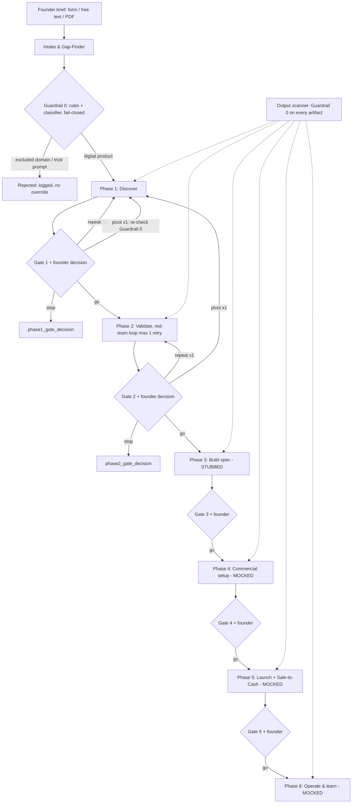
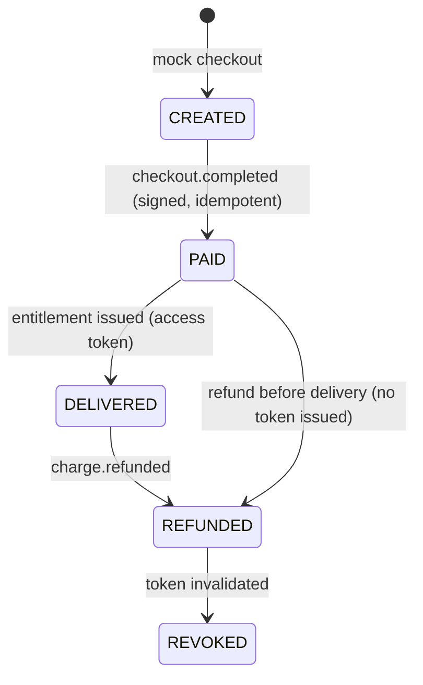
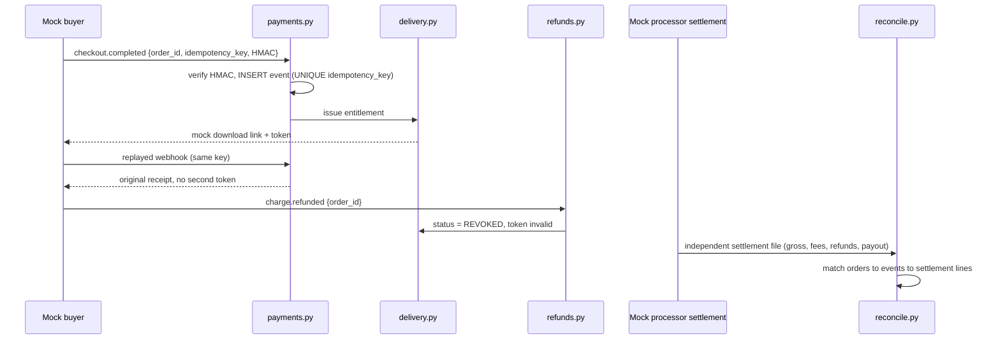

# Architecture: Evidence-Gated Open-Source Venture Builder

## Overview

This system is an open-source, evidence-gated multi-agent venture builder. It takes a **structured founder brief** (idea, skills, budget, available time, target market, values — typed, pasted as free text, or uploaded as a PDF) and moves it through six phases toward a validated digital product. When the evidence is weak it recommends **`STOP` — don't launch this**, and the founder decides at every gate.

The system has two layers:

* **Control plane (deterministic Python):** a persisted state machine in `orchestrator.py` that moves a run from phase to phase. It also holds the safety filters (`gates.py`), the founder approval store (`approval.py`), the source ledger and citation verifier, the decision logger (`callbacks.py`) and the mocked Sale-to-Cash engine. Every gate outcome is **computed by code** from structured agent output. No LLM can approve, publish or advance a run.
* **Agent plane (Google ADK):** inside each phase, `LlmAgent`, `LoopAgent` and custom `BaseAgent` components do the language work: structuring the brief, synthesising research, red-team critique and drafting specs. They run only on **free-tier hosted open-weight models**: Gemma 4 through the Google AI Studio free tier, and Qwen3 / Llama 4 through the Groq free tier via ADK `LiteLlm`. The cost is USD 0.00 per run.

Design principles:

1. **LLMs propose, Python decides.** Agents return Pydantic-validated JSON. Thresholds in `config/gates.yaml` turn it into `go` / `repeat` / `pivot` / `stop`.
2. **Evidence by construction.** Models cite only source keys (`S1..Sn`) from a ledger that Python filled from real fetches. Each claim must include a verbatim quote that is checked against the fetched text. Unknown keys are rejected, and claims whose quote does not match are downgraded to `ASSUMPTION`.
3. **The founder holds every key.** Every side-effecting function is wrapped by `@requires_founder_approval`. Agents have no tool that can reach the approval store.
4. **Honest labels everywhere.** `ASSUMPTION`, `MOCKED`, `STUBBED` and `SYNTHETIC` badges are added by the artifact writer, not by the model, so they cannot be dropped.
5. **Zero cost and reproducible.** `docker compose up` starts the app plus a self-hosted SearXNG search service. With no API keys the app runs in a labeled offline mock mode, so smoke tests always pass.



## Phases

### Phase 1: Discover

* **Goal:** Turn the founder's starting idea into a sharp, locally grounded opportunity statement plus up to three alternative angles, all backed by verified sources.
* **Agents and tools:**
  * `intake_agent` (`agents/intake.py`, `LlmAgent`, Gemma 4 26B-A4B, temperature 0.2, `output_schema=FounderBrief`). It accepts the structured form, free text, or a PDF. PDFs are converted to Markdown in memory with `markitdown`, capped at 20 pages, and never written to disk. The agent normalises the brief into required fields: problem, target user, geography, language, skills, budget, hours per week, values and tech preference. When interactive mode is on it asks **at most 3** clarifying questions. Otherwise it fills each gap with a labeled `ASSUMPTION`.
  * **Guardrail 0** (`gates.py`) runs on the normalised brief before any search (see Gates).
  * `query_planner` (deterministic templates plus one small LLM expansion) produces 6–8 queries across five evidence categories: demand, competitors, pricing and willingness to pay, local constraints (purchasing power, payment habits, regulation), and channels. Queries are bilingual (English plus the target market's language, e.g. Arabic for Egypt) and region-tagged.
  * `evidence_collector` (`agents/researcher.py`, custom `BaseAgent`, **no LLM**). It sends queries to SearXNG first and falls back to `ddgs`. Fetching runs in parallel with `httpx` (6 s timeout, 45 s total budget). `trafilatura` extracts the text, and fetched text is sanitised against injection (treated strictly as data, wrapped in delimiters, instruction-like lines stripped). Results are deduplicated by URL and registrable domain. Passages of about 120 words are ranked with BM25 (`rank_bm25`) against each category query, and the top passages are kept within a token budget. Macro context (GDP per capita PPP, internet penetration) comes from the keyless World Bank Indicators API, with citable URLs.
  * `researcher_agent` (`LlmAgent`, Gemma 4 31B, `output_schema=ResearchFindings`) writes claims as `{category, text, source_keys, quote}` and scores up to three opportunity angles.
  * `citation_verifier` (deterministic) rejects unknown source keys, fuzzy-matches each quote against the cited passage (`rapidfuzz` partial ratio ≥ 90) and downgrades failures to `ASSUMPTION`. Only then does it expand keys to real URLs.
* **Method:** The model never sees or writes a URL; it sees `S1..Sn` passages only. Every source is stored in the ledger with its URL, title, domain, fetch time, a SHA-256 hash of the text and the passages.
* **Outputs:** `outputs/phase1_step1_intake.md`, `outputs/phase1_step2_opportunities.md`, `outputs/phase1_step3_sources.json`, `outputs/phase1_gate_decision.md`.
* **Status:** Working.

### Phase 2: Validate

* **Goal:** Attack the Phase 1 findings, design the business on a Lean Canvas, and pre-register a falsifiable demand test.
* **Agents and tools:**
  * `validator_agent` (`agents/validator.py`, `LlmAgent`). It runs on a **different model family** from the researcher (Qwen3-32B on Groq, with Llama 4 Scout as fallback) so the critique is independent. It applies Mom-Test discipline: it separates evidence of past behaviour (people already paying, searching or complaining) from opinions and hypotheticals. It ranks the riskiest assumptions by impact × uncertainty, states kill criteria, and lists evidence gaps as targeted queries.
  * `validation_loop` (`LoopAgent(sub_agents=[validator_agent, gap_researcher], max_iterations=2)`). If the validator finds no blocking gaps it escalates and exits after the first pass. Otherwise `gap_researcher` re-runs `evidence_collector` on the gap queries only, and the validator runs once more. `gap_researcher` checks `state["retry_used"]` and does nothing on the second iteration, so there is **at most one retry**. (`max_iterations=1` would allow zero retries.)
  * `canvas_builder` (`LlmAgent`) fills the nine Lean Canvas blocks. Each block cites source keys or is labeled `ASSUMPTION`.
  * `demand_test_designer` writes a pre-registered test: channel, metric, threshold, duration, and cost within the founder's budget. Its status is always **`NOT RUN`**. Simulated results are never used as evidence.
* **Method:** Python computes the Evidence Score *E* and the Viability Score *V* (see Gates). The founder–fit check compares the estimated MVP build hours and cost with the founder's stated time and budget. The values check compares the business model with the founder's stated values.
* **Outputs:** `outputs/phase2_step1_critique.md`, `outputs/phase2_step2_lean-canvas.md`, `outputs/phase2_step3_demand-test-plan.md`, `outputs/phase2_gate_decision.md`.
* **Status:** Working.

### Phase 3: Build

* **Goal:** Hand the founder a build-ready MVP specification, not a deployed product.
* **Agents and tools:** `builder` (`agents/builder.py`). It writes a Markdown PRD with user stories traced to Lean Canvas problems, scope cut to the founder's available hours, and a stack chosen from the founder's preference or documented defaults. It also writes a user-guide draft and a self-contained static HTML waitlist preview with a visible `MOCKED — form not connected` banner. The preview has no real collection, no countdowns and no testimonials.
* **Method:** Structural checks: required PRD sections exist, every feature traces to a validated problem, and no core feature rests only on `ASSUMPTION`. The output scanner rejects income promises, fake social proof and urgency patterns.
* **Outputs:** `outputs/phase3_step1_mvp-spec.md`, `outputs/phase3_step2_waitlist-preview.html`, `outputs/phase3_gate_decision.md`.
* **Status:** STUBBED. The spec is generated; no code is built and nothing is deployed.

### Phase 4: Commercial setup

* **Goal:** Draft price points and policies without any payment integration.
* **Agents and tools:** `commercial` (`agents/commercial.py`). It builds pricing tiers in the local currency from competitor prices cited in Phase 1, or labels them `ASSUMPTION` when none were found. A price-to-income sanity check uses the World Bank context. It also writes Terms, Privacy and Refund policy templates marked "template — have it reviewed; not legal advice".
* **Method:** The system has zero payment SDKs and zero payment keys. Gate 4 fails if any of the three policies is missing or if pricing contradicts the canvas.
* **Outputs:** `outputs/phase4_step1_pricing.md`, `outputs/phase4_step2_policies.md`, `outputs/phase4_gate_decision.md`.
* **Status:** MOCKED.

### Phase 5: Launch

* **Goal:** Stage launch assets and prove the Sale-to-Cash logic end to end on a local simulator.
* **Agents and tools:** `launch_simulator` (in `orchestrator.py`) drafts the store listing and announcement copy. Drafts are held as `PENDING_FOUNDER_APPROVAL` and are never posted. `payments.py`, `delivery.py`, `refunds.py` and `reconcile.py` run the deterministic local simulation (see Sale to cash).
* **Outputs:** `outputs/phase5_step1_launch-drafts.md`, `outputs/payment_test_log.md`, `outputs/phase5_gate_decision.md`.
* **Status:** MOCKED.

### Phase 6: Operate and learn

* **Goal:** Show how post-launch metrics would drive a persevere, pivot or stop decision.
* **Agents and tools:** `operate` (`agents/operate.py`) generates **`SYNTHETIC`** funnel, refund and support-ticket data from a fixed seed. It compares the data with the thresholds pre-registered in Phase 2 and writes a decision memo. Synthetic data only shows the decision logic; it is never presented as a result.
* **Outputs:** `outputs/phase6_step1_operate-memo.md`.
* **Status:** MOCKED.

## Gates

Every gate is computed in `gates.py` from structured state and thresholds in `config/gates.yaml`, then held at `PENDING_APPROVAL` until the founder decides in `approval.py`.

| Gate | When | Automated checks | Outcomes | `STOP` recommended when |
| :--- | :--- | :--- | :--- | :--- |
| **Gate 0** | Intake, every pivot, every artifact | Excluded categories; trick intents; credential or money-handling requests | `go` / `stop` (no override) | Any rule or classifier hit |
| **Gate 1** | End of Phase 1 | *E* ≥ 40; at least 3 distinct domains; target market and geography set | `go` / `repeat` / `pivot` / `stop` | *E* < 25, or a saturated market with no niche angle |
| **Gate 2** | End of Phase 2 | *E* ≥ 55; *V* ≥ 3.0; no unresolved kill assumption; canvas complete; founder fit | `go` / `repeat` (1×) / `pivot` (1×) / `stop` | Any hard-stop rule below |
| **Gate 3** | End of Phase 3 | PRD sections; feature-to-problem tracing; output scan clean; labels present | `go` / `repeat` / `stop` | Scan fails or founder rejects scope |
| **Gate 4** | End of Phase 4 | 3 policies present; pricing consistent; no payment SDK or keys | `go` / `repeat` / `stop` | Compliance check fails |
| **Gate 5** | End of Phase 5 | Idempotency, revocation and reconciliation checks pass; drafts approved | `go` / `pivot` / `stop` | Reconciliation mismatch or founder halts launch |

### Guardrail 0 (layered, fail-closed)

1. **Normalise:** Unicode NFKC, lowercase, Arabic letter normalisation, leetspeak and spacing collapse.
2. **Deterministic rules:** an English and Arabic lexicon plus regex for the excluded categories (physical goods; financial, investment or crypto products; health or legal advice) and for trick intents (fake reviews or testimonials, fake sign-ups, impersonating a person or brand, guaranteed income, fake urgency or countdowns, collecting passwords or card numbers, holding or moving money).
3. **Classifier:** an LLM at temperature 0 returns JSON `{category, intent, confidence}`. A run is blocked if **either** layer flags it. If the classifier errors or times out, the run is blocked with an explanation.
4. **Where it runs:** on the brief, on every pivot or alternative angle, and as an **output scanner** on every artifact before it is written.

### Scoring

**Evidence Score *E* (0–100):** 40 × (evidence categories with ≥ 1 verified claim ÷ 5) + 25 × (verified claims ÷ all claims) + 20 × min(distinct domains, 5) ÷ 5 + 15 × share of sources dated within 24 months (undated sources count half).

**Viability Score *V* (1–5):** the mean of validator ratings for demand signal, competitive gap, local willingness to pay against the proposed price, founder fit and values fit. Each rating must cite source keys, and ratings without citations are capped at 2.

**Hard-stop rules (Gate 2):**

* *E* < 35 after the retry is used.
* A kill assumption is contradicted by verified evidence, for example a free local incumbent that covers the core job.
* The estimated build exceeds 2 × the founder's available hours, or the budget.
* The proposed monthly price exceeds the configured share of local monthly income per capita.

**Decision order:** Gate 0 hit → `stop` → hard-stop → `stop` → *E* below threshold with the retry unused → `repeat` → *V* between 2.0 and 3.0 with a validator niche that passes Gate 0 → `pivot` → otherwise `go`.

### Code-enforced founder control (`approval.py`)

* Run states: `RUNNING → PENDING_APPROVAL(gate_n) → APPROVED | PIVOTED | STOPPED`. They are persisted in SQLite (`state.db`), so runs survive restarts.
* Decisions arrive only through `POST /api/runs/{run_id}/gates/{gate_id}/decision` (dashboard) or `python approval.py decide ...` (CLI). Both require the local founder token printed at startup, and both write `"approved_by": "founder"` to `decision_log.json`.
* `@requires_founder_approval(gate_id)` wraps every phase transition and every side-effecting function (publishing a preview, launching a simulation, releasing drafts). Without a matching approval record it raises `ApprovalRequired`.
* The founder may override a recommended `STOP` only with a typed reason. The override is logged with `"founder_override": true`, and the `STOP` banner stays on every later artifact. Gate 0 blocks cannot be overridden.

## Sale to cash

**Status: `MOCKED`.** There are no payment processors, no sandbox APIs and no payment SDKs, and no money is held or moved. Everything is a deterministic local simulation in `payments.py`, `delivery.py`, `refunds.py` and `reconcile.py`, logged to `outputs/payment_test_log.md`.





1. **Payment triggers delivery.** A signed `checkout.completed` event (local HMAC secret) moves the order to `PAID`, and in the same transaction `delivery.py` issues a single entitlement.
2. **Refund revokes access.** `charge.refunded` sets the entitlement to `REVOKED` and invalidates the token. A refund that arrives before delivery means no token is ever issued.
3. **Idempotency prevents double delivery.** The event insert and the entitlement issue run in one SQLite transaction, with a `UNIQUE` constraint on `idempotency_key`. A replay returns the original receipt. Out-of-order events are queued until their predecessor state exists.
4. **Reconciliation.** `reconcile.py` compares three independent records: internal orders, payment events, and a settlement file produced by the mock processor using a fee schedule labeled `ASSUMPTION`. It checks that every paid order has one event and one settlement line, that the totals match, and that gross − fees − refunds = payout, with refunded fees handled as configured. All money is stored as **integer minor units** (e.g. piastres), never floats. The test suite injects a deliberate mismatch and confirms that Gate 5 fails.

## Data flow

```
Founder brief (form | free text | PDF -> markitdown, in memory)
        |
        v
FounderBrief (Pydantic) --> Guardrail 0 --x--> rejected (logged)
        |
        v
query_planner --> SearXNG / ddgs --> httpx fetch --> trafilatura --> sanitise
        |                                                     |
        |                                    BM25 passage ranking (token budget)
        |                                                     |
        |                    SQLite: source ledger {S1: url, hash, passages} + query cache
        v
researcher_agent (sees S-keys + passages only) --> ResearchFindings JSON
        |
        v
citation_verifier (unknown key -> reject, quote mismatch -> ASSUMPTION, key -> URL)
        |
        v
validation_loop (validator <-> gap_researcher, max 1 retry) --> Critique + Canvas
        |
        v
gates.py (E, V, hard-stops) --> PENDING_APPROVAL --> founder decision (approval.py)
        |
        v
artifact writer (+ badges, + output scanner) --> outputs/phase<N>_step<M>_<name>.<ext>

Every agent, tool and gate event --> callbacks.py --> decision_log.json
  {timestamp, agent, action, sources, model, cost, approved_by, [run_id, phase, outcome, tokens]}
```

* **State contract:** ADK `session.state` carries only validated Pydantic objects (`FounderBrief`, `SourceLedgerRef`, `ResearchFindings`, `Critique`, `LeanCanvas`, `GateResult`) and source keys, never raw transcripts or page text.
* **Token accounting:** `after_model_callback` reads `usage_metadata` from each response. Per-run token totals are written to the run summary. Cost is reported as USD 0.00 because only free tiers are used.
* **Logging:** writes go through a single-writer queue into SQLite and are exported to `decision_log.json`, so concurrent agents cannot corrupt the file. Every entry carries the seven required keys, with `null` or `[]` when they do not apply.
* **Storage:** committed: `outputs/`, `decision_log.json`, `config/`, `prompts/`. Git-ignored: `.env`, `state.db`, uploads, caches.
* **Failure handling:** the model gateway falls back on rate limits (HTTP 429) from Gemma 4 31B → Qwen3-32B → Llama 4 Scout, and the switch is logged in `model`. Search falls back from SearXNG to `ddgs` to the cached ledger. With no keys at all, the app runs in labeled offline mock mode.

## Built vs. stubbed

| Phase / component | Module | Status | Details |
| :--- | :--- | :--- | :--- |
| Run state machine and gating | `orchestrator.py` | **Working** | SQLite-persisted phase transitions; ADK agents within each phase |
| Guardrail 0 and output scanner | `gates.py` | **Working** | English/Arabic rules plus classifier, fail-closed |
| Intake and gap-finder | `agents/intake.py` | **Working** | Form, free text or PDF in; `ASSUMPTION` tagging; ≤ 3 questions |
| Evidence collector and researcher | `agents/researcher.py` | **Working** | SearXNG/ddgs, trafilatura, BM25, World Bank API, verified citations |
| Red-team validator and canvas | `agents/validator.py` | **Working** | Cross-model critique, one bounded retry, pre-registered demand test |
| Evidence gates and `STOP` engine | `gates.py`, `config/gates.yaml` | **Working** | *E* and *V* scores, hard-stops, decision order |
| Founder approval | `approval.py` | **Working** | Approval decorator, founder token, override logging |
| Decision log and dashboard | `callbacks.py`, `app.py` | **Working** | Live log; FastAPI dashboard with progress, sources, badges and gate buttons |
| MVP spec and waitlist preview | `agents/builder.py` | **STUBBED** | Markdown PRD and static HTML preview; no code build or hosting |
| Pricing and policies | `agents/commercial.py` | **MOCKED** | Pricing table and policy templates; no payment SDKs or keys |
| Launch drafts and Sale-to-Cash | `payments.py`, `delivery.py`, `refunds.py`, `reconcile.py` | **MOCKED** | Local signed events, idempotency, revocation, three-way reconciliation |
| Operate and learn | `agents/operate.py` | **MOCKED** | `SYNTHETIC` metrics against pre-registered thresholds |
| Offline mode | `llm_gateway.py` | **MOCKED** | Deterministic responder used when no API keys are set (tests and CI) |

## Roadmap

1. **Real demand signals:** founder-authorised connectors for a self-hosted waitlist form and anonymised interview transcripts, so the pre-registered Phase 2 test can actually run and feed Gate 2.
2. **Regional evidence adapters:** pluggable country packs (local payment methods, statistics offices, marketplaces) maintained by the community, starting with Egypt and the wider MENA region.
3. **Sandboxed MVP build:** upgrade Phase 3 from spec to code scaffolding in an isolated container with linting and Playwright tests, still behind Gate 3 approval.
4. **Fully local mode:** an optional Ollama profile in `docker-compose.yml` so the whole pipeline can run offline on open weights.
5. **Evaluation harness:** a public set of benchmark briefs (strong, weak and adversarial) with expected gate outcomes, run in CI on every pull request to track `STOP` accuracy and citation precision.