# HatchAI: evidence-gated open-source venture builder

HatchAI is an open-source team of cooperating agents that takes a founder's idea for a **digital** product through six gated phases: **Discover → Validate → Build → Commercial setup → Sell, deliver and get paid → Operate and learn**. It researches the market on the live web, checks every quote against its source, scores the evidence in code, and stops at a founder approval gate between every phase. When the evidence holds up, it **generates, tests and boots a runnable MVP**. When it doesn't, it says **REPEAT**, **PIVOT** or **STOP**.

**In one minute:**

- **Grounded research, audited.** Live, keyless sources (web metasearch, Reddit and Hacker News threads, Wikipedia, World Bank). Every claim is a verbatim quote that code re-matches to its source; anything unmatched is labelled `ASSUMPTION`. Every cited source is then **audited**: its publication date and age, who is speaking (official statistics, academic, community, independent, or a **vendor writing about its own market**), and whether the quote came from the fetched page or only from a search snippet.
- **An Advisor interprets the results.** After Gates 1, 2 and 3 an Advisor agent writes a memo: what the evidence says the pain is, whether the plan addresses it, the weakest assumption, the cheapest test this week, and what would change the recommendation. "What would change it" is computed: it re-runs the gate with each cited source removed. Every sentence must cite a verified source or say `ASSUMPTION`, or code deletes it.
- **Code decides; the founder approves.** Evidence score (E, 0–100), viability score (V, 1–5) and GO / REPEAT / PIVOT / STOP are computed in Python. No model can touch them. Nothing proceeds, is published, sent, spent or signed without a founder decision enforced in `approval.py`.
- **Real software out of Phase 3.** 5 tested archetypes (SM-2 flashcards, booking, habit tracker, directory, course). The generated app gets its own tests, which must pass and the server must boot before Gate 3 can say GO. Ideas no template fits get a written spec and an honest STOP.
- **Reproducible.** Live research is captured into evidence snapshots. `python orchestrator.py demo` replays them offline and gives the same gates, scores and files on every run.
- **$0, local, open.** No paid service or API key. An optional local open-weight model (`qwen3` via Ollama) does two small text tasks.

### Headline result: a live run under the strict evidence rule (captured 2026-11-17)

Brief: *an AI-powered flashcard and spaced-repetition study tool for university students in Egypt, focused on STEM.* Snapshot: [`evidence_snapshots/strong_v2_scenario.json`](evidence_snapshots/strong_v2_scenario.json). Outputs: `outputs/*-headline-v2.*`.

| Step | What happened (computed by code) |
|---|---|
| Gate 1, round 1 | **REPEAT** (E = 84.2): sources found for 4 of 5 categories, but no passage names *university students + this problem + Egypt*, so demand stays unverified |
| Gate 1, round 2 | **PIVOT** (E = 84.2): a broader second search still finds no demand evidence. The system narrows to the best-evidenced angle |
| Gate 1, pivot | **GO** (E = 83.9): demand verified from an Egyptian news source; pricing is **not** verified (`ASSUMPTION`) |
| Gate 2 | **GO** (V = 4.0 of 5): pre-launch viability. Willingness to pay is only proven by the demand test, so V can't reach 5 yet |
| Gate 3 | **GO**: MVP *STEM Recall* generated; **23/23** of its own tests pass and the server boots |
| Gate 4 | **GO**: pricing anchored on cited competitor prices (median USD 8.00), capped to **USD 2.57/month** by World Bank income data; drafts of terms, privacy and refund policies (MOCKED, "not legal advice") |
| Gate 5 | **GO**: sale-to-cash simulation (MOCKED) passes idempotency, refund revocation and reconciliation; launch drafts held `PENDING_FOUNDER_APPROVAL` |
| Phase 6 | **INSUFFICIENT_DATA**: 0 real visitors, below the pre-registered 300 minimum. The system does not invent traction |

**Advisor on this run:** the Gate 1 memo finds that **removing source S12 alone would turn GO into REPEAT** (E 83.9 → 75.4), and that S12 describes the size of the market, not a pain. In other words, the GO hinges on one page. On the original strong scenario, the Gate 3 memo finds that the demand evidence names a *card-preparation burden* (S6) that no competitor source mentions, and that the generated MVP covers **0 of 1** verified pains. Neither finding changes a gate: they are what a founder should know before approving.

**Evidence audit of this run:** 7 cited sources, 86% dated, 56% published within the last 18 months, 71% independent, 56% of quotes come from search snippets. Competitors are backed only by vendor or stale sources, and one channel source dates from 2015; the system shows a warning for each. **This is a GO on modest evidence, and the files say so.**

**Other committed scenarios:**
- **Weak brief** ("generic study notes", no target user, no country): **Gate 1 STOP** before any build or spend.
- **REPEAT → GO** (Arabic calligraphy workshop booking, Jordan): too thin in round 1 (E = 46.5), GO after a broader second round.
- **Before/after:** the first captures were scored with an older, looser relevance rule (v1). The original strong scenario got E = 95 and all-GO under v1. Replayed under the strict rule (v2), it gets **REPEAT** instead, and the new audit flags 56% of its cited sources as vendors writing about their own market. The comparison is in [`WALKTHROUGH.md`](WALKTHROUGH.md).

## Quickstart

```bash
docker compose up
```

Then open **http://localhost:8000** in your browser (verified 2026-11-17: `/health` returns `ok` and the web UI loads).

1. Type an idea (who it's for, which country, what problem) and press **Start research**.
2. The run page shows the six phases as a row of eggs. They crack open as each phase finishes, and a diamond between eggs shows each gate's outcome.
3. At each gate you see the verdict (GO / REPEAT / PIVOT / STOP), the scores and the Advisor memo. Then decide: **Approve / Repeat / Pivot / Stop**, or proceed against the recommendation with a written reason.
4. Every output file and the folder of the generated MVP are listed on the right.

**Example runs** (top menu, `/demo`) shows the committed demo outputs, with the Advisor memos in bold, without running anything.

**Without Docker** (Python 3.12):

```bash
pip install -r requirements.txt
uvicorn app:app                           # web UI on http://localhost:8000
python orchestrator.py demo               # reproducible demo: replays the 4 committed snapshots offline
python -m pytest                          # 135 tests, all passing (run 2026-11-17)
```

**More commands:**

```bash
python orchestrator.py run "<brief>"      # CLI run; you approve every gate at the prompt
python orchestrator.py demo --live        # strong/weak/headline briefs do fresh live research (results vary)
python orchestrator.py capture "<brief>" evidence_snapshots/my_scenario.json   # live run, saved for replay
python orchestrator.py replay evidence_snapshots/strong_v2_scenario.json        # one scenario, offline
cd generated_mvps/demo-headline && python server.py --port 8080                 # run a generated MVP
python demand_test_traffic.py generated_mvps/demo-strong --visitors 300 --signups 20   # labelled TEST traffic
python orchestrator.py measure demo-strong                                      # re-run Phase 6 on stored counts
docker compose --profile llm up           # also starts Ollama and pulls the local model
```

A step-by-step guide with the full verification status is in [`WALKTHROUGH.md`](WALKTHROUGH.md).

## What works and what is mocked

| Step | Status | Notes |
|---|---|---|
| 1.1 Intake | **Working** | Deterministic parser (no LLM); unstated fields → `UNKNOWN` |
| 1.2 Guardrail 0 | **Working** | Excluded products and trick intents, fail-closed, no override; re-run on pivots |
| 1.3 Evidence collection | **Working** | Web metasearch (`ddgs`, 5 backends with fallback), Reddit-targeted demand query, vendor pricing pages, HN Algolia, Wikipedia, World Bank API. Ledger with URL, fetch time, SHA-256, per-passage origin (page / search snippet / API) and the page's own publication date (HTML metadata) |
| 1.4 Synthesis + citation check | **Working** | Extractive (no LLM): claims are verbatim fetched passages, re-matched to their source. Relevance rule v2 needs the brief's own user, problem and local terms |
| 1.5 Evidence quality audit | **Working** (advisory) | Publication date (page metadata, snippet date, relative dates such as "8 hours ago", API dates); freshness (fresh ≤ 18 months / aging ≤ 36 / stale); who is speaking (official, academic, reference, community, independent, vendor); share of snippet-only quotes; warnings. Shown in every findings file; **not part of the E score**, so replays of older captures stay exact |
| 1.6 / 2.4 / 3.4 Advisor memo | **Working** (rule-based) | After Gates 1–3: pain, plan fit, weakest assumption, evidence-specific risks with kill criteria, cheapest test, counterfactual gate re-runs, evidence-based angles (unaddressed pain, underserved place or language, price gap). `insight_check.py` deletes any sentence without a verified source key or `ASSUMPTION`. Advisory: never changes E, V, a gate or the pivot |
| Gap analysis | **Working** (advisory) | `evidence.pain_signals` extracts the pain wording from verified demand quotes; `builder.coverage` matches it to MVP features. Gate 3 shows "the MVP covers X of Y verified pains" without affecting the gate |
| Model-written memo summary | **Working**, optional (`HATCHAI_ADVISOR_LLM=1`) | Local model sees only the verified quotes; the same citation check runs on its sentences. Off by default and in replays |
| Web UI | **Working** | Hatch identity (yolk yellow, shell white); six-egg phase track; gate verdict with the Advisor memo beside the decision buttons; Markdown output viewer; example-runs page; phone layout |
| Evidence capture / replay | **Working** | Snapshots of live evidence; replay re-runs checks, scores and gates offline, labelled REPLAY |
| Gate 1 | **Working** | E score; GO / REPEAT (2nd research round) / PIVOT / STOP. All four outcomes appear on real captured evidence |
| 2.1 Red-team critique + viability | **Working** | Rule-based critique; V computed in code |
| 2.2 Lean Canvas | **Working** | Blocks cite source keys or say `ASSUMPTION` |
| 2.3 Demand test | **Working** design / **STUBBED** execution | Pre-registered thresholds; `NOT_RUN` until the founder runs it |
| Gate 2 | **Working** | GO / REPEAT / PIVOT / STOP |
| 3.1 MVP spec + template choice | **Working** | Template only above a compatibility score and margin; features traced to problems and risks |
| 3.2 MVP code generation | **Working** for 5 templates / **STUBBED** otherwise | Stdlib Python app: API, UI (Arabic RTL), consented waitlist, SQLite. Unfitting ideas get a spec-only document and Gate 3 STOP |
| 3.3 MVP verification | **Working** | Runs the generated tests (~23) and boots the server |
| Gate 3 | **Working** | Tests must pass; REPEAT rebuilds once; then STOP |
| 4.1 Pricing | **Working** | Cited competitor prices (or `ASSUMPTION`); World Bank affordability cap |
| 4.2 Terms / privacy / refund | **MOCKED** | Templates labelled "not legal advice" |
| 5.1 Launch drafts | **Working** drafts / **STUBBED** posting | Held as `PENDING_FOUNDER_APPROVAL`; never posted |
| 5.2 Checkout → delivery → refund → reconcile | **MOCKED** | Local HMAC-signed simulation; idempotency, revocation, reconciliation tested. No real payment processor |
| 6.1 Metrics | **Working** | Visits, unique visitors, consented sign-ups stored in the MVP's `app.db`; REAL and TEST traffic kept apart |
| 6.2 Decision vs pre-registered rule | **Working** | Decides on REAL traffic only (`INSUFFICIENT_DATA` below the visitor minimum) |
| MVP hosting / deployment | **STUBBED** | The founder runs the generated app locally |
| Founder approval + decision log | **Working** | Founder token in an HttpOnly cookie; every agent action appended to `decision_log.json` |

## Architecture

A deterministic control plane (`orchestrator.py`, `gates.py`, `approval.py`) owns state, scoring and approvals, and the agents in `agents/` do the domain work for each phase. `evidence.py` is the web-grounding layer: it plans queries per evidence category, collects from five keyless sources, fetches each page, stores a hashed ledger, re-checks every quote against its source and audits freshness and credibility. Gates read only numbers computed by code, and each phase reads the previous phases' stored results (brief → findings → canvas and demand test → MVP spec → pricing → payment amount → Phase 6 thresholds and the MVP's own database). The builder assembles the MVP from tested templates in `mvp_templates/` and proves it by running the generated tests in a subprocess. After Gates 1–3 the Advisor (`agents/advisor.py`) reads the stored results and writes an insight memo, and `insight_check.py` removes any sentence that doesn't cite a verified source or say `ASSUMPTION`. An optional local open-weight model (`llm_gateway.py`, OpenAI-compatible) handles two text tasks in Phase 3 and, if switched on, a short Advisor summary. See [ARCHITECTURE.md](ARCHITECTURE.md) for phases, gates, sale to cash and data flow.

```mermaid
flowchart LR
  B[Founder brief] --> G0{Guardrail 0}
  G0 -->|blocked| X[STOP, no override]
  G0 --> P1[1 Discover: research + quote check + audit] --> GA{Gate 1}
  GA -->|REPEAT / PIVOT| P1
  GA -->|GO + founder| P2[2 Validate: critique, canvas, demand test] --> GB{Gate 2}
  GB -->|GO + founder| P3[3 Build: generate + test + boot MVP] --> GC{Gate 3}
  GC -->|GO + founder| P4[4 Commercial: pricing, policies] --> GD{Gate 4}
  GD -->|GO + founder| P5[5 Sell: drafts held, checkout sim] --> GE{Gate 5}
  GE -->|GO + founder| P6[6 Operate: real metrics vs pre-registered rule]
```



## Models and free resources

| Model | Weights | How to run free | Used for |
|---|---|---|---|
| `qwen3:0.6b` (verified; the compose default), larger models such as `qwen3:8b`, or any open-weight model on a local OpenAI-compatible server | Open | Ollama (`ollama pull qwen3:0.6b`), `docker compose --profile llm up`, llama.cpp `llama-server`, vLLM or LM Studio | Phase 3: (1) template-synonym suggestion when no template clears the threshold, (2) MVP name + tagline. Optional (`HATCHAI_ADVISOR_LLM=1`): (3) a citation-checked Advisor summary after Gates 1–3 |
| none | n/a | Default. Replays and the default demo always run `LLM_DISABLED` | Deterministic name, tagline and template choice |

All research APIs (`ddgs` metasearch, Hacker News Algolia, Wikipedia, World Bank) are free and need no keys. `llm_gateway.is_open_weight` rejects closed-weight model names (`gpt-*`, `gemini-*`, `claude-*`).

**What the model may and may not do.** It never writes code, claims or evidence, and never sets a score or gate. A suggested template synonym counts only if its phrase appears verbatim in the idea and maps to an existing keyword of a template that already matched (at most +1). Name and tagline are length-checked, scanned for forbidden phrases and rejected if they look like code or URLs. Bad, empty or slow answers fall back to deterministic text with the label `LLM_UNAVAILABLE_FALLBACK`. Every output file carries an `LLM mode:` line.

**Check it with your own model:**

```bash
ollama pull qwen3:0.6b && ollama serve
export HATCHAI_LLM_BASE_URL=http://localhost:11434/v1 HATCHAI_LLM_MODEL=qwen3:0.6b HATCHAI_NO_LLM=0
python scripts/verify_llm.py      # exit 0 = VERIFIED round trip with a real model
```

**Verified with a real open-weight model (2026-11-17).** `qwen3:0.6b` (522 MB) served by Ollama 0.11.4 on the build machine: `scripts/verify_llm.py` reports `VERIFIED` (schema-valid answer in 0.4 s), and the Phase 3 name-and-tagline task returned `LLM_LIVE` and passed every code check. Requests use grammar-constrained JSON (`response_format: json_schema`), because without it this small model echoed the schema back instead of answering. The 24 protocol tests in `tests/test_llm_protocol.py` (stub server) cover timeouts, retries, schema validation, fallback and proof that model output leaves E, V and the gates unchanged. The optional Advisor summary was also run on `qwen3:0.6b`: 3 of 3 sentences cited a verified source and passed the check. Their quality is limited by the model's size (one sentence contradicted itself), which is why the summary is optional, labelled as model-written, and never replaces the rule-based memo. The committed demo runs `LLM_DISABLED` on purpose, so it is reproducible.

## Cost per run

About **$0.00 per run**. The research APIs are free and keyless, and the model (if used) runs on your own machine. A run makes at most 2 small LLM calls (Phase 3), each capped at 120–200 output tokens, plus 3 optional Advisor summaries (≤ 700 tokens each) when `HATCHAI_ADVISOR_LLM=1`; a live research run makes about 30 HTTP requests to free public APIs.

## Demo video

Recording pending; the link will be added here.

## What our system will NOT do

- Promise income, profit or success. Generated text is scanned for income promises and urgency phrases.
- Create fake reviews, testimonials, sign-ups, user counts or countdown timers. Seed content is labelled SAMPLE DATA, and test traffic is labelled TEST and excluded from decisions.
- Pose as the founder, a customer or another brand. Launch drafts are for the founder to post personally.
- Hold, move or refund money, create accounts, or store passwords or card numbers. Payments are a local simulation.
- Publish, send, spend or sign anything without an explicit founder decision recorded in code.
- Work on physical goods, financial, investment or crypto products, or health, medical or legal advice.
- Hide core features behind a paywall. The generated MVP's core is free; paid tiers add capacity only.
- Present an unverified claim as fact, a vendor's claim as independent evidence, or simulated metrics as real results.

## How the project stays alive after the hackathon

- **Maintainers:** the founding team triages issues and reviews PRs weekly.
- **Roadmap:** feed the evidence audit into the score (a v3 rule that discounts vendor-only and stale evidence); claim cross-checking across sources; more MVP archetypes and an LLM code-diff mode gated by the generated tests; connect the Phase 5 entitlement to the MVP's paid tier; a sandbox payment connector behind founder approval; Arabic-language regional sources; a CI benchmark of briefs with expected gate outcomes.
- **Community:** MIT-licensed. Adding an archetype means one `core.py` plus its tests in `mvp_templates/`, a well-scoped first contribution. Adding a source type means one collector function in `evidence.py`.
- **Funding:** no paid tier. It runs on free, keyless APIs and an optional model on the user's own machine; community sponsorship only if a public demo needs hosting.
